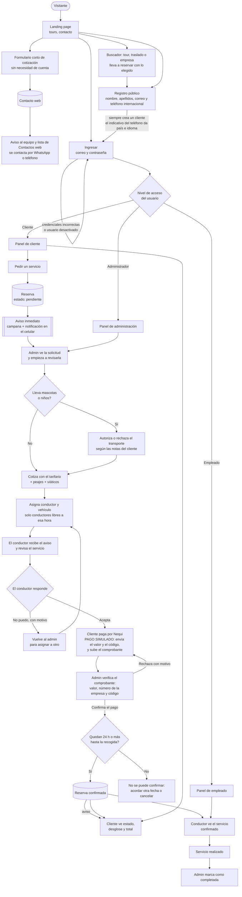
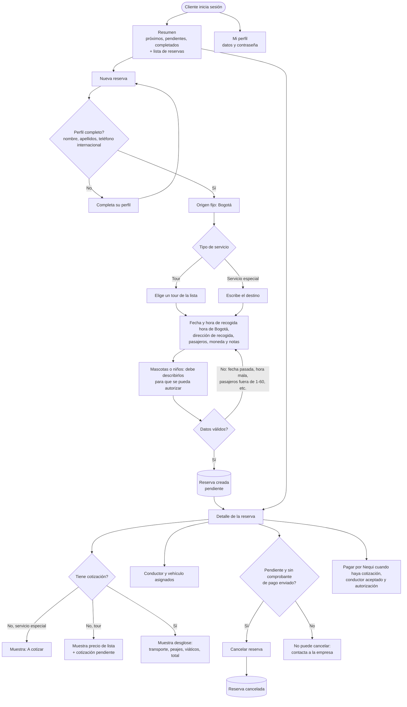
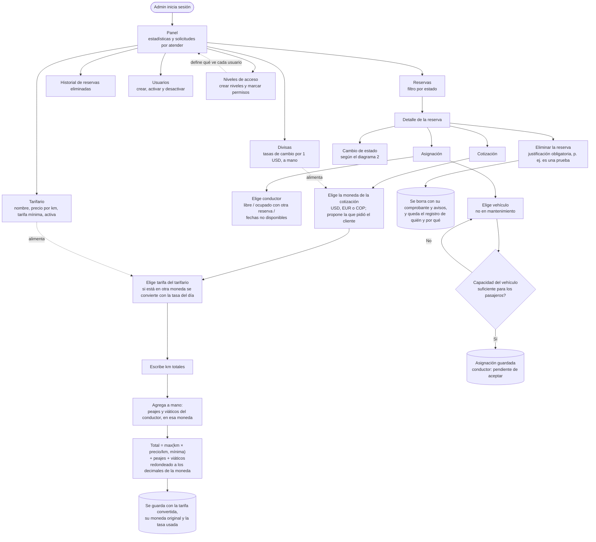
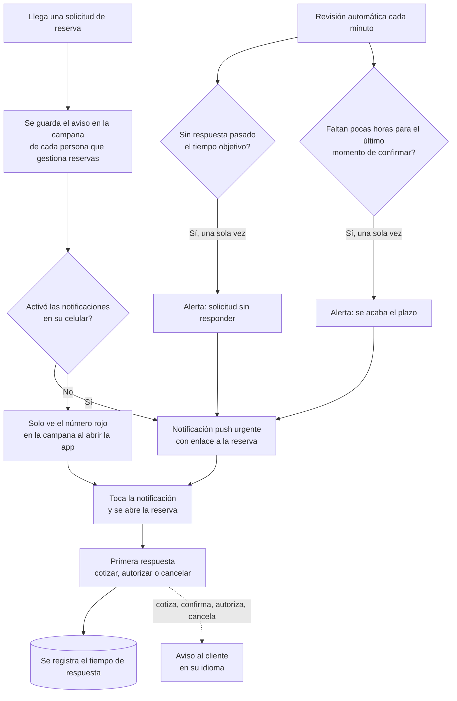
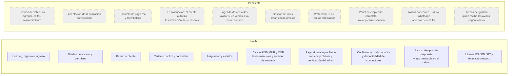

# DSB Transportes — Diagrama de flujo del proceso

Estado del sistema a la fecha. Los diagramas usan [Mermaid](https://mermaid.js.org/): se ven directamente en GitHub y en VS Code (con la extensión *Markdown Preview Mermaid Support* o similar).

Lo que aún **no** está construido aparece en gris y con borde punteado (sección 6).

---

## 1. Flujo general

---

## 2. Estados de una reserva

```mermaid
stateDiagram-v2
    [*] --> pendiente: el cliente envía la solicitud

    pendiente --> confirmada: al confirmar el admin el pago; exige cotización, autorización resuelta, conductor aceptó y 24 h de anticipación
    pendiente --> cancelada: admin cancela, o el cliente si aún no envió comprobante de pago

    confirmada --> completada: admin marca el servicio como realizado
    confirmada --> cancelada: solo el admin (el cliente debe contactar a la empresa)
    confirmada --> pendiente: admin la devuelve a pendiente

    cancelada --> pendiente: admin la reabre

    completada --> [*]: estado definitivo
```

Reglas que aplica el sistema:

- Solo se puede **cotizar** y **asignar** mientras la reserva está *pendiente* o *confirmada*.
- No se puede **confirmar** una reserva sin cotización.
- **Pago (simulado):** la reserva solo queda confirmada cuando el administrador verifica el comprobante de pago. El cliente puede pagar cuando hay cotización, conductor aceptado y autorización (si aplica). Paga en pesos colombianos (la cotización se convierte con la tasa del día), indica su número Nequi y la referencia, escribe en el mensaje de la transferencia el código único de la reserva y sube el comprobante; el admin comprueba valor, número de la empresa y código. Si lo rechaza, el cliente puede corregirlo y reenviarlo. Con el comprobante enviado la cotización queda bloqueada.
- **Eliminar una reserva:** por ahora solo el administrador, con una justificación obligatoria (por ejemplo, "es una prueba"). Se borra la reserva con su comprobante de pago y sus avisos; queda un registro (quién, cuándo, por qué y los datos principales) en *Reservas eliminadas*. Opcionalmente se avisa al cliente y al conductor. En producción, quien deberá autorizar la eliminación es el cliente que hizo la reserva.
- **Cancelación por el cliente:** solo mientras la reserva está pendiente y sin comprobante enviado. Después, cualquier cambio lo hace la empresa.
- Debe haber un **conductor asignado que haya aceptado** el servicio. Si lo rechaza (con motivo), la reserva vuelve al administrador para asignar a otro. Con la reserva confirmada solo se puede cambiar el vehículo; para cambiar de conductor hay que devolverla antes a *pendiente*.
- Si lleva **mascotas o niños**, el admin debe **autorizar** el transporte antes de confirmar; si lo rechaza (con una nota para el cliente) no se puede confirmar. La decisión solo se toma mientras está *pendiente*.
- La recogida debe ser como mínimo **24 horas después de formalizar (confirmar)** la reserva. Se exige al reservar y de nuevo al confirmar; el valor (24 h) se cambia en *Ajustes de atención*. Todo en hora de Bogotá, y el origen siempre es Bogotá.
- *Completada* es definitiva: no se puede cambiar, cotizar ni asignar.

---

## 3. Panel de cliente

---

## 4. Panel de administración

**Divisas.** USD es la moneda base. Cada tarifa y cada tour tienen su moneda; la cotización se emite en una moneda elegida, y se guarda con la tasa del momento, así que cambiar las tasas no altera cotizaciones ya hechas. Los precios de lista y las equivalencias (≈) se muestran en la moneda que cada visitante elige en la barra superior.

---

## 4b. Avisos, tiempos de respuesta y celular

- **Tiempo de respuesta** = desde que llega la solicitud hasta la primera acción del equipo. El objetivo es configurable (60 min por defecto) y el panel muestra el tiempo medio de los últimos 30 días y qué porcentaje cumplió el objetivo.
- **Plazo para confirmar** = hora de recogida − 24 h. El detalle de cada reserva muestra cuánto queda y, si ya pasó, no deja confirmar.
- **Quién recibe los avisos del equipo:** el administrador y cualquier nivel con el permiso *Cotizar, asignar y cambiar el estado de reservas*.
- **Celular:** la app se puede instalar (PWA) y las notificaciones push solo funcionan con HTTPS; en iPhone, además, hay que instalarla en la pantalla de inicio.

**Disponibilidad del conductor.** Un conductor no está disponible si (1) marcó esas fechas como no disponibles en *Mi disponibilidad*, o (2) ya tiene otro servicio activo que se cruza en horario. Un servicio ocupa desde la recogida hasta su duración (la del tour, o la duración por defecto de *Ajustes de atención* en los servicios especiales; 8 h de fábrica). El admin no puede asignar a un conductor no disponible, y si el conductor rechaza un servicio o se cancela, queda libre de nuevo. Si el conductor no responde en el tiempo acordado (60 min de fábrica) se avisa al administrador.

---

## 5. Niveles de acceso y permisos

El acceso se decide por **permisos**, no por nombre de rol. Cada nivel es un conjunto de permisos que el administrador marca en *Niveles de acceso*. Los cambios se aplican de inmediato; si se desactiva a un usuario, pierde la sesión en su siguiente clic.

| Permiso | Administrador | Empleado | Cliente |
|---|:---:|:---:|:---:|
| Ver el panel de administración | ✅ | | |
| Crear y activar/desactivar usuarios | ✅ | | |
| Ver todas las reservas | ✅ | | |
| Cotizar, asignar y cambiar estado de reservas | ✅ | | |
| Gestionar el tarifario por kilómetro | ✅ | | |
| Gestionar divisas y tasas de cambio | ✅ | | |
| Verificar y confirmar pagos | ✅ | | |
| Eliminar reservas (con justificación) | ✅ | | |
| Gestionar tiempos de respuesta y anticipación | ✅ | | |
| Gestionar niveles de acceso | ✅ | | |
| Ver sus servicios asignados | ✅ | ✅ | |
| Aceptar o rechazar los servicios que le asignan | ✅ | ✅ | |
| Indicar sus fechas no disponibles | ✅ | ✅ | |
| Crear sus propias reservas | ✅ | | ✅ |
| Ver sus propias reservas | ✅ | | ✅ |
| Cancelar sus propias reservas (solo antes de pagar) | ✅ | | ✅ |
| Pagar sus reservas | ✅ | | ✅ |

- El **Administrador** siempre tiene todos los permisos y no se puede editar.
- Los niveles de **Empleado** y **Cliente** vienen con esos permisos por defecto, pero se pueden cambiar.
- El admin puede crear niveles nuevos (por ejemplo, *Supervisor* o *Despachador*) y nadie puede conceder permisos que no tiene.
- Todos los usuarios tienen **Mi perfil** (cambiar nombre, teléfono y contraseña).

---

## 6. Pendiente de construir

